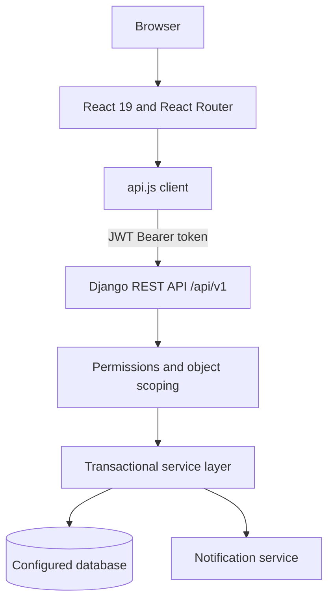
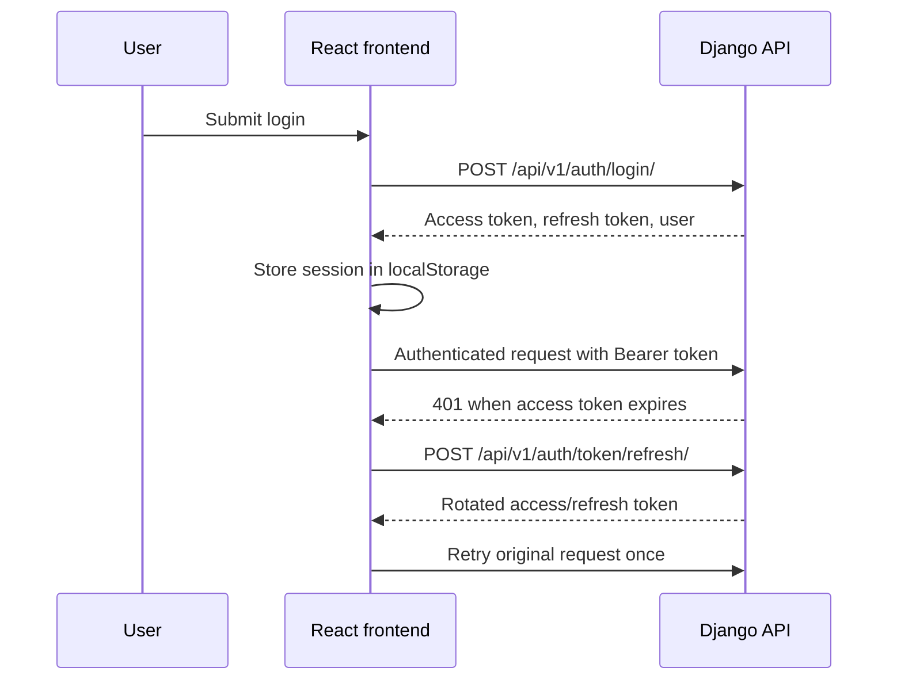
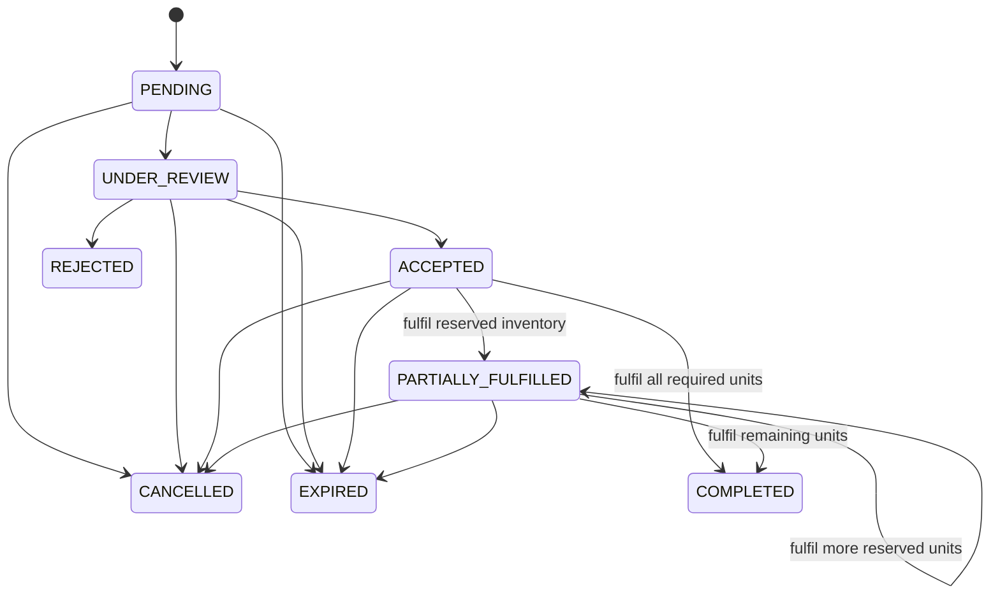
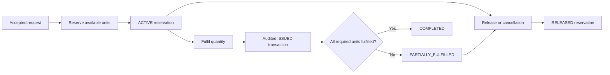

# BloodConnect Architecture

## System overview

The Vite application is a client-rendered single-page application. `src/App.jsx` keeps the layout, navigation, authorization gate, and Suspense fallback eager. `src/RoutePages.jsx` contains the lazy-loaded page implementations. `src/api.js` supplies the common API root, JSON parsing, JWT header, single-flight refresh, and session storage behavior.

The Django project exposes REST endpoints through app routers and URL modules. Views validate transport-level input and authorization; service modules contain the stateful business operations that require transactions and row locking.

## Backend applications

| App | Responsibility |
|---|---|
| `accounts` | Custom user model, application roles, registration/login/logout, current-user data, password change, permission helpers |
| `blood_banks` | Public directory, bank ownership, verification records, nearby search, CSV import |
| `locations` | Address/coordinate models, distance helper, and transient forward/reverse geocoding adapter |
| `blood_requests` | Request state, history, bank assignment, matching, reservation, fulfilment, expiry |
| `core` | Health endpoint, public/private dashboards, isolated demo fixtures |
| `donors` | Donor profiles, screening assessments, history, nearby matching, donation recording |
| `inventory` | Blood groups/components, stock records, transactions, stock-update services |
| `notifications` | Recipient-scoped notifications and read state |

### Address-based nearby search

The Nearby Search form shows Address and Radius in separate sections. Manual addresses are sent to `POST /api/v1/locations/geocode/` only when Search is submitted. The current-location action asks the browser for geolocation, then calls `POST /api/v1/locations/reverse-geocode/` and shows the readable address. The frontend keeps coordinates only in page memory for the existing `GET /api/v1/blood-banks/nearby/` request. Editing the address discards those coordinates; changing radius retains them. No user search location is stored in a database or profile, and coordinates are not rendered in this UI.

The geocoding adapter defaults to the public OpenStreetMap Nominatim service. Configure `GEOCODING_BASE_URL` to switch providers compatible with the same search/reverse JSON contract, and set `GEOCODING_USER_AGENT` to identify the deployed application with a real contact URL or email. The frontend credits OpenStreetMap contributors. The provider's top-ranked forward match is accepted and its full canonical address is shown to the user before results; a more ambiguous address can be corrected and searched again. Reverse lookup is a best matching OSM address, not a guarantee of postal precision.

Public Nominatim permits moderate interactive use with an **absolute maximum of one request per second across the application**, an identifiable User-Agent or Referer, visible attribution, and caching where possible. It forbids autocomplete, bulk/systematic lookups, and repeated client queries. The adapter sends requests only on explicit actions, reserves a one-second cache slot before each provider request, caches forward results for 24 hours, and never caches reverse lookups of precise browser coordinates. The API also applies per-client throttles. Deploy a **shared Django cache** across all application workers for the provider slot and forward cache; Django's default local-memory cache only coordinates one worker. For higher traffic, use a suitable hosted provider or self-hosted Nominatim. See the [current Nominatim usage policy](https://operations.osmfoundation.org/policies/nominatim/) and [search](https://nominatim.org/release-docs/develop/api/Search/) and [reverse](https://nominatim.org/release-docs/develop/api/Reverse/) documentation.

## Frontend structure

- `main.jsx` mounts `BrowserRouter`, `AuthProvider`, and `App` under React Strict Mode.
- `App.jsx` implements the persistent shell, skip link, global navigation, protected-route wrapper, route table, and lazy-loading boundary.
- `RoutePages.jsx` implements home, authentication, bank discovery, requests, dashboard, notifications, donor, and bank-owner workspace pages.
- `AuthContext.jsx` restores `/auth/me/`, stores the authenticated user, exposes logout, and derives frontend staff visibility from active roles returned by the API.
- `api.js` stores tokens and user data in `localStorage`, attaches access tokens, rotates refresh tokens after a 401, and ensures only one refresh request is active.
- `Dialog.jsx` supplies named modal semantics, initial focus, Tab/Shift+Tab trapping, Escape handling, backdrop handling, and trigger-focus restoration.

## Authentication flow

Access tokens last 15 minutes and refresh tokens last 7 days. Refresh rotation and blacklist-after-rotation are enabled. Logout blacklists the submitted refresh token when possible and clears the local browser session regardless of network availability.

## Authorization model

Authorization is enforced by the backend; frontend role visibility is only a usability layer.

1. A Django superuser has the global bypass implemented by the permission helpers.
2. An active application `ADMIN` role grants global BloodConnect administrative authority.
3. A blood-bank owner has authority scoped to their own active bank and its inventory/assigned requests.
4. Normal users and donors are scoped to their own user, donor profile, requests, and notification recipient.
5. Django `is_staff` only controls Django administration access and does not grant BloodConnect business privileges.
6. `BLOOD_BANK_STAFF` is not sufficient for bank-scoped business access because no membership relationship currently connects a staff user to a specific bank. Current bank operations use ownership or Application Admin authority.

Object visibility is also filtered: public users see active/public verified or directory-imported banks; request querysets are restricted to the requester, the assigned bank owner, or an Application Admin; notifications are restricted to their recipient.

## Blood-request lifecycle

`REJECTED`, `CANCELLED`, `COMPLETED`, and `EXPIRED` are terminal. Generic status updates are restricted to bank-review states; `PARTIALLY_FULFILLED` and `COMPLETED` are reached through the dedicated fulfilment workflow so request state and stock movement remain atomic.

Every transition creates `BloodRequestStatusHistory`. Assignment changes create `BloodRequestBankAssignment`. Relevant transitions notify the requester and, where applicable, the assigned bank.

## Inventory reservation and fulfilment

Inventory-changing services use database transactions and `select_for_update`. They reject negative totals and totals below reserved units. Transactions retain before/after quantities, reason, reference, and actor. Reservation, fulfilment, cancellation, and release operations coordinate request state and reserved stock inside transactional services.

## Donor and donation architecture

A donor profile belongs to one user and blood group. Eligibility assessments are informational and stored separately. Nearby search returns only eligible, available, consent-declared donors with coordinates, and exposes the restricted response fields defined by its serializer. Donation recording is owner/Application Admin scoped and delegates to the donation service, which also integrates completed donations with inventory.

The current frontend exposes donor self-service and history, but nearby search and donation recording remain API-only/future UI scope.

## Notifications and dashboards

Notification creation is called by request workflow services. Notification queries are recipient-scoped, with actions for one or all notifications and an unread count.

The public dashboard returns aggregate, privacy-safe platform totals. The authenticated dashboard returns data scoped to the current user's account, requests, donor profile, and owned-bank responsibilities.

## Reference and source data

Blood groups and blood components are stored reference models populated by `seed_inventory_reference`. Blood-bank directory records can be imported from a CSV with `import_blood_banks`; imported records are marked as directory data rather than user-verified records. Raw datasets are intentionally ignored by Git.

## Security boundaries and limitations

Implemented controls include authenticated-by-default DRF permissions, JWT rotation/blacklisting, object and ownership checks, throttling, audit histories, transactional inventory protection, CORS configuration, and production HTTPS/HSTS/secure-cookie settings.

Known limitations:

- tokens are stored in browser `localStorage`;
- direct donor contact has no separate communication-consent model beyond the current profile declarations;
- no bank-membership model scopes `BLOOD_BANK_STAFF` users;
- actual screen-reader testing has not been performed;
- production hosting is not configured or deployed.
